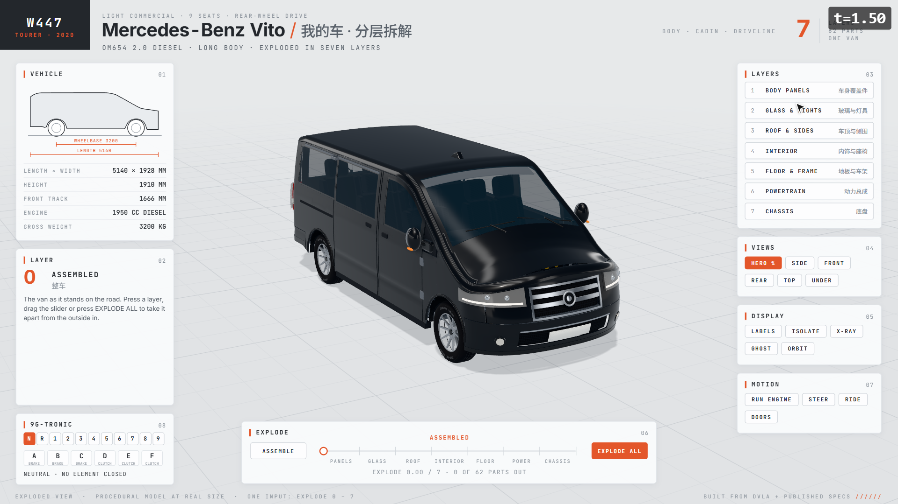
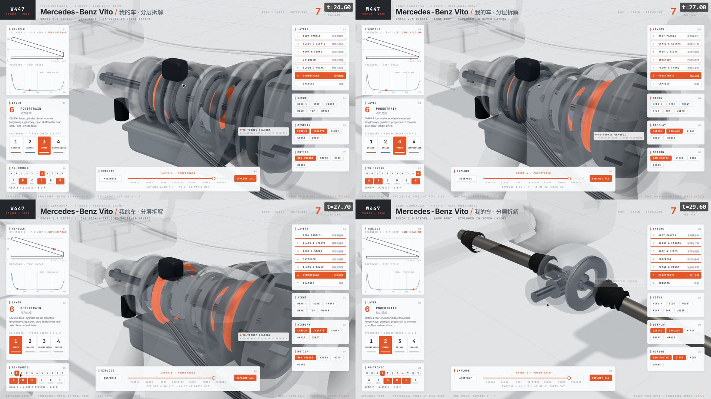

# Mercedes-Benz Vito W447 · 分层拆解 / Take-apart

**▶ Open it: https://milkjds.github.io/vito-teardown/** — or download `index.html` and double-click it (works offline).

An interactive 3D model of a 2020 Vito Tourer (W447, long body, OM654 2.0 diesel) that comes apart in seven layers,
with the mechanisms running: pistons, valves and firing order, the 9G-TRONIC gearbox shifting through its gears, the
differential in a turn, steering, suspension and doors. Leave it alone and it gives a guided tour; click anywhere to
take over.

一个可以动手拆的 3D 模型：2020 款 Vito（W447 长轴，OM654 2.0 柴油）。七层逐层拆开，发动机活塞和气门、9G-TRONIC 变速箱换挡、
差速器、转向、悬挂和车门都会动。不操作时自动演示，点任意位置接管。**请用电脑打开**（Chrome / Edge / Safari / Firefox）。

| Control | |
|---|---|
| LAYERS `1`-`7`, slider, ASSEMBLE `0` / EXPLODE ALL `e` | take it apart layer by layer |
| VIEWS (`v`), drag, wheel | camera |
| DISPLAY: labels `l`, isolate `i`, x-ray `x`, ghost `g`, orbit `o` | how it is shown |
| MOTION: run engine `r`, steer `s`, ride `b`, doors `d` | the mechanisms |
| 9G-TRONIC (bottom left): N, R, 1-9 | gears: which brakes/clutches close, the ratio |

## What is real and what is assumed
- **Real:** body dimensions (5140 × 1928 × 1910 mm, wheelbase 3200, front track 1666, 205/65 R16C), shape calibrated on a
  side photo of a W447 Tourer, OM654 bore × stroke 82 × 92.3 mm (1950 cc), compression 15.5:1, firing order 1-3-4-2,
  9G-TRONIC tooth counts, couplings and gear ratios (all ten reproduced from the tooth counts to 4 decimals).
- **Assumed (drawing only):** rod length, valve timing, steering ratio, axle and differential tooth counts, the
  indicator diagram's boost and burn, the gearbox's planet count and module, everything not visible from outside.

## Sources
- Dimensions: published specifications (auto-data.net, carexpert.co.nz, Parkers); DVLA / DVSA records.
- Body shape: side photo of a W447 eVito Tourer by Anthony Levrot, Wikimedia Commons, CC BY-SA 4.0 (used as a
  measurement reference, not included).
- 9G-TRONIC: de.wikipedia.org/wiki/Mercedes-Benz_9G-Tronic, en.wikipedia.org/wiki/Mercedes-Benz_9G-Tronic_transmission.

## Credits and licences
Built with the *teardown* skill (MIT, elvarofficial/teardown; kit from whaleyxbt/claude-motion, MIT) and three.js
(MIT). Fonts embedded: Inter and JetBrains Mono (SIL Open Font License 1.1). Everything is procedural geometry written
in code; no third-party 3D models.

Unofficial fan model, not affiliated with or endorsed by Mercedes-Benz. Mercedes-Benz, Vito and 9G-TRONIC are
trademarks of Mercedes-Benz Group AG.
